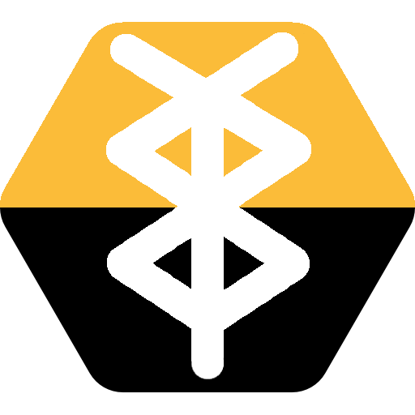
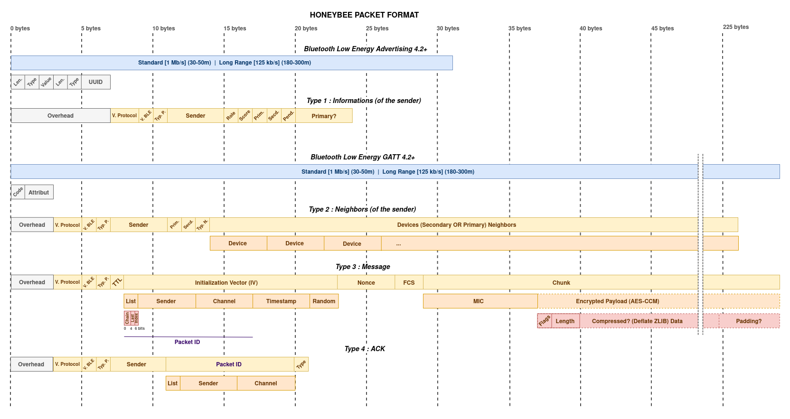

# HoneyBee 🐝

 

**A lightweight, (secure?), and relay-based Bluetooth Low Energy (BLE) protocol for fragmented, anonymous, and encrypted communication between devices.**

> _It is an experimental protocol and not an official standard. No security checks by a specialized audit._

> [**Click here for read the Documentation.**](https://4surix.github.io/honeybee/)

---

## **Overview**

It is designed for:
- **Device-to-device relaying**.
- **Secure data transmission** (AES-CCM encryption, channels-based keys).
- **Fragmentation** of long messages into chunks of 32 or 200 bytes (constant padding classes; the legacy unpadded `1..200` range is test-only), linked via `List` fields; each `Message (0x03)` fragment carries a CRC-16/CCITT-FALSE transport FCS, an 18-byte logical IV (`List0 || Sender4 || Channel4 || Timestamp4 || Random4`), and the 8-byte MIC travels tag-first at the head of Chunk[`Index == 0`] (bound to the packet-0 IV).
- **Secure P2P messaging** with fragmentation and relay (ex: chat).
- **Very low debit**: ≈ 12–17 kB of compressed data per channel per 15 minutes for typical chat sizes (6–25 kB across message sizes), bounded by the shared relay budget and not by the sender's own bucket (see [Relay](docs/mechanisms/RELAY.md) §1d for the token model).

Key Features:
- **Easy and low provisioning**.
- **Low complexity** (suitable for embedded and mobile devices).
- **Anti-replay and integrity checks** (TTL, chain PoW over `List0 || Sender4 || Channel4 || Timestamp4 || Random`, AES-CCM `MIC` computed with the packet-0 IV, `Timestamp` anti-replay hint).

Not Ideal for:
- Long-range IoT.
- High-throughput applications.
- Standardized, interoperable solutions.
- Large-scale deployments with dynamic group joining.

---

## Why this project ?

When I was a kid, I had a Nintendo 2DS. It had the "StreetPass" feature, which automatically collected the Mii profiles of people we passed by, as well as exchanging certain data for games that supported this feature. I was a huge fan. It gave a physical and tangible dimension to virtual and abstract data. I felt like it brought people living in the same area closer together. 

The same went for "PictoChat." Even though its range was only about fifty meters and we could have just talked face-to-face, PictoChat offered a different way to communicate. Above all, the feeling it gave was completely different from a long-distance messaging app with the exact same features. The local aspect brought something that the global scale simply doesn't have.

I feel like that is missing today. I don't understand why Nintendo didn't continue StreetPass on the Nintendo Switch, even though it's a portable console.

Through this protocol, HoneyBee, I want to bring back that unique aspect you can't find anywhere else. I want developers to create features that only work within a local setting again. I want their users to experience that local social connection mediated through the virtual world, which is so different from an online connection.

Later on, I discovered mesh networks, and I really liked the concept.

I find it unfortunate that every app recreates its own mesh system from scratch each time. On top of reinventing the wheel, every mesh network is isolated. Packets from App A's mesh network cannot be carried by App B's mesh network and read by App B.

Creating a common mesh protocol allows us to centralize technical achievements, simplify maintenance, and build a single, unified mesh network in order to have as many relays as possible.
