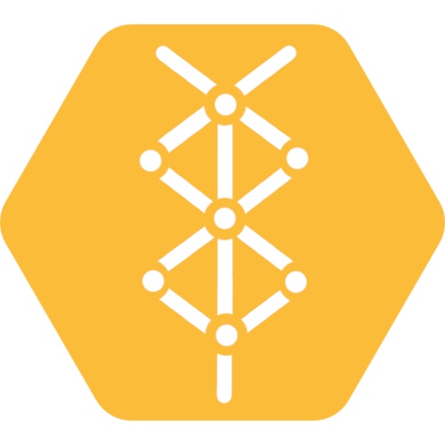
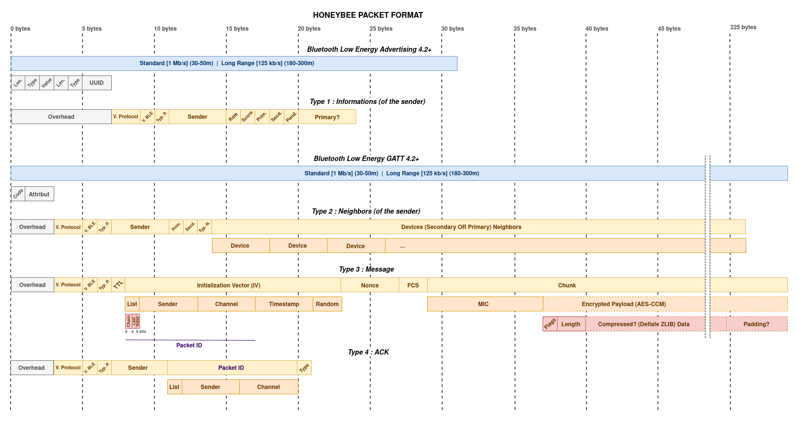

# HoneyBee 🐝

    

**A lightweight, (secure?), and relay-based Bluetooth Low Energy (BLE) protocol for fragmented, anonymous, and encrypted communication between devices.**

> It is an experimental protocol and not an official standard. No security checks by a specialized audit.

---

## **Overview**

It is designed for:
- **Device-to-device relaying**.
- **Secure data transmission** (AES-CCM encryption, channels-based keys).
- **Fragmentation** of long messages into chunks of 1..200 bytes, linked via `List` fields; each `Message (0x03)` fragment carries a CRC-16/CCITT-FALSE transport FCS, an 18-byte logical IV (`List0‖Sender4‖Channel4‖Timestamp4‖Random4`), and the 8-byte MIC travels tag-first at the head of Chunk[`Index == 0`] (bound to the packet-0 IV).
- **Secure P2P messaging** with fragmentation and relay (ex: chat).
- **Very low debit**: Send ≈ 6–25 kilo-bytes _(of data after compression)_ per channel per 15 minutes (≈ 12–17 kB for typical chat sizes) — bounded by the shared relay budget of 40 tokens/min (`cost = 1 + len//64` per padded fragment, RELAY §1d), not by the sender's own bucket.

Key Features:
- **Easy and low provisioning**.
- **Low complexity** (suitable for embedded and mobile devices).
- **Anti-replay and integrity checks** (TTL, chain PoW over `List0‖Sender4‖Channel4‖Timestamp4‖Random`, AES-CCM `MIC` computed with the packet-0 IV, `Timestamp` anti-replay hint).

Not Ideal for:
- Long-range IoT.
- High-throughput applications.
- Standardized, interoperable solutions.
- Large-scale deployments with dynamic group joining.

---

## **Documentation**

1. [PROTOCOL.md](docs/PROTOCOL.md) : Technical specification of the protocol.
2. [SECURITY.md](docs/SECURITY.md) : Know security issues.
