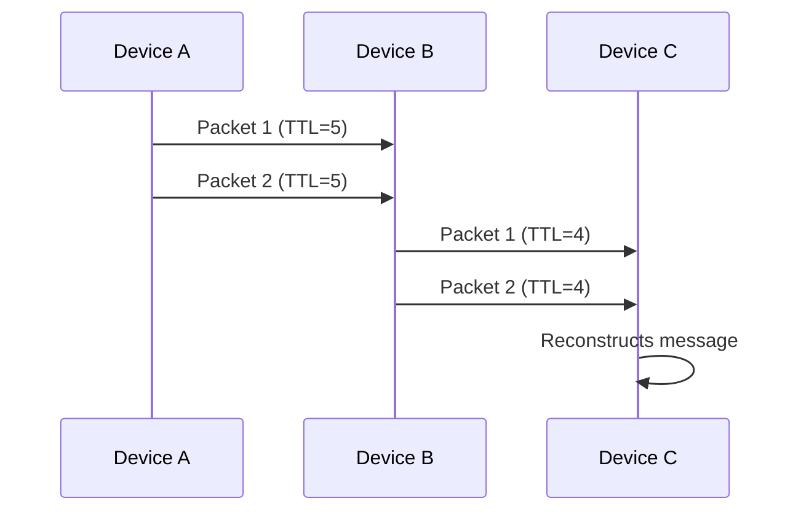

# Protocol Specification

1. [Introduction](#intro)
2. [Protocol Overview](#overview)
3. [Mechanisms](#mechanisms)

---

## 1. Introduction

### **1.1 Purpose**

This document describes a **Bluetooth Low Energy (BLE)** protocol for:

- **Relay-based communication** between devices (ex: phone-to-phone).
- **Fragmented data transmission** (1..200-byte chunks linked via `List` fields; MIC tag-first in Chunk of `Index == 0`).
- **Secure and anonymous** messaging (AES-CCM encryption, channel keys, integrity checks).

### **1.2 Prerequisites**

- Basic understanding of BLE and AES-CCM encryption.
- Familiarity with fragmentation and cryptographic hashing.

---

## 2. Protocol Overview

### **2.1 Resume**

| Concept           | Description                                             |
| ----------------- | ------------------------------------------------------- |
| **Relay**         | Only `Primary` nodes relay, and only `Message (0x03)` packets (GATT only), with random jitter + heard-again suppression, up to a TTL limit (`1..255`, validated at reception before dedup). Strict dedup cache on canonical `Packet ID` (TTL/FCS excluded, see Packet §0.5): duplicates are never re-relayed. `0x01`/`0x02`/`0x04` are 1-hop, never relayed. Pipeline: `Secondary -> serving Primary (via Primary? attachment) -> mesh of Primaries -> each serving Primary -> its attached Secondaries`. |
| **Bearer**        | `Informations (0x01)`: BLE Advertising, 17 bytes protocol + Adv overhead (4-byte Sender + `Primary?` attachment field), 1-hop beacon (never relayed). `Neighbor (0x02)`, `Message (0x03)`, `ACK (0x04)`: BLE GATT only, behind `Code/Attribut` overhead (see [frame overview](images/img-frame.png)). Header is `V. Protocol (2, 0xBEE0) + V. BLE (1) + Typ. P. (1)`. Only `0x03` is relayed; `0x02`/`0x04` are 1-hop. Primaries mesh over GATT (Relay 5); Secondaries flush via Primary-initiated rendezvous to the Primary named in `Primary?` (Relay 6). |
| **Rendezvous**    | A Secondary attaches to exactly ONE elected serving Primary `(Score, RSSI, Sender ID)` + hysteresis (Relay 6.1b), queues its `0x03`, sets `Pend.=1` (binary non-empty flag) and `Primary?` = serving Primary ID in its 17-byte beacon (4-byte Sender); only that Primary connects (mutex via `Primary?` + attached-list `Typ. N.` = `0x03` snapshot, Relay 6.5); both flush bidirectionally in one session; handover is Secondary-initiated only. An overloaded Primary's `Score` carries an exponential load malus on its attached count (Network §3.E), steering new Secondaries to a less-loaded peer. |
| **Fragmentation** | Long messages are split into 1..200-byte chunks, linked via a `List` field (2 bytes, Chain 4b / Last 6b / Index 6b); reassembled as `stream = tag8 ‖ ciphertext` (MIC in Chunk 0). |
| **Channel**        | Packets belong to a channel _(4 bytes, 32-bit retable)_, each with its own 32-byte master; epoch keys derived on demand (HKDF: master → session → channel).              |
| **Security**      | `AES-CCM-128` encryption (one 8-byte MIC per message computed with the packet-0 IV, transported tag-first at the head of Chunk[Index==0], encrypt-then-fragment), 18-byte logical `IV` (List0‖Sender4‖Channel4‖Timestamp4‖Random4 → `nonce12 = SHA256(IV)[0..11]`), HKDF key hierarchy with 15-min rotation, chain PoW `d=12`, per-address rate limiting.      |
| **Privacy**       | One-way rotating addresses (`HMAC(secret_local, epoch)`, secret never provisioned/transmitted), per-device non-aligned rotation jitter `[0, 120 s]`, generic GATT service (no fixed Service UUID), independent relay emission (0–500 ms, anti stimulus→response), uniform observables (two padding classes, jittered advertising, constant TX power), documented residual limit + presence obfuscation (`SECURITY.md` §3). |

### **2.2 Comparison with Existing Standards**

|                  | **HoneyBee**      | **Bluetooth Mesh** | **Thread**       | **Zigbee**      | **LoRaWAN**      |
| ---------------- | ----------------- | ------------------ | ---------------- | --------------- | ---------------- |
| **Provisioning** | Pre-shared key    | Dedicated          | Certificate / PSK  | Trust Center  | OTAA/ABP         |
| **Size Payload** | Max 790 bytes     | Max 16 bytes       | Max 63 bytes     | Max 68 bytes    | Max 51-222 bytes |
| **Security**     | AES-CCM-128   Channels  | AES-CCM-128  | AES-128   DTLS | AES-128   Trust Center | AES-128   E2E optionnal |
| **Range**        | ~30-250m            | ~30-50m     | ~30-50m       | ~10-100m    | ~1-40 km          |
| **Latency**      | Low               | Medium             | Low              | Medium          | High             |

### **2.3 Communication Flow**

---

## 3. Mechanisms

- [Acknowledgement Mechanism](mechanisms/ACKNOWLEDGEMENT.md)
- [Channels Mechanism](mechanisms/CHANNELS.md)
- [Identification Mechanism](mechanisms/IDENTIFICATION.md)
- [Network Mechanism](mechanisms/NETWORK.md)
- [Packet Mechanism](mechanisms/PACKET.md)
- [Relay Mechanism](mechanisms/RELAY.md)
- [Confidentiality Mechanism](mechanisms/CONFIDENTIALITY.md)
- [Send Mechanism](mechanisms/SEND.md)
- [Receive Mechanism](mechanisms/RECEIVE.md)
