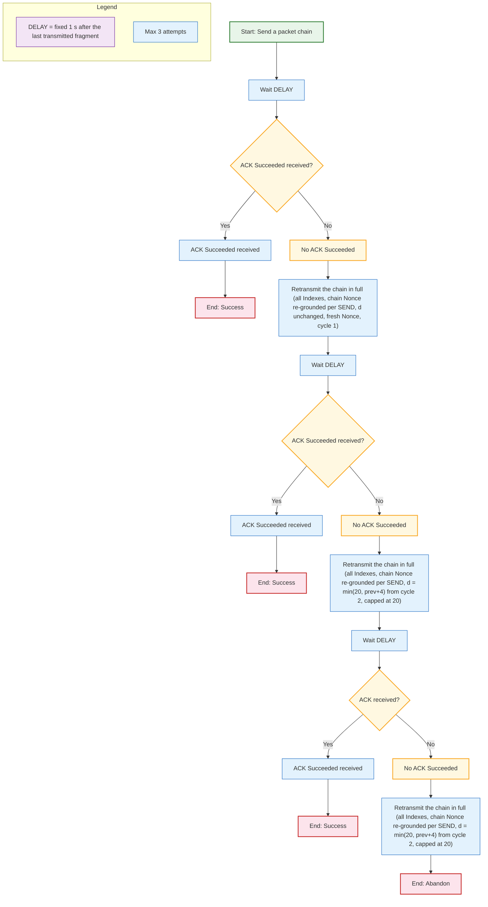
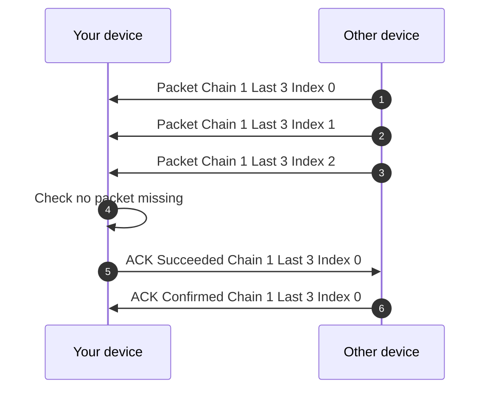
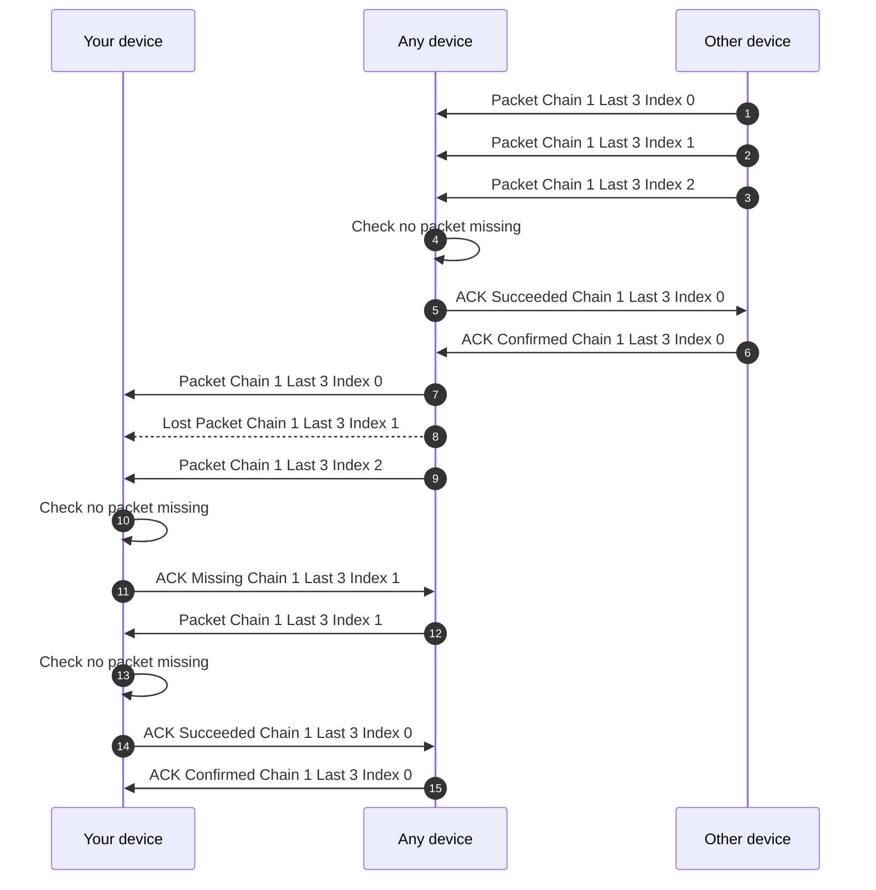

# Acknowledgement Mechanism  
  
> [Acknowledgement (data networks) - Wikipedia](https://en.wikipedia.org/wiki/Acknowledgement_(data_networks))

### Functioning

#### Lost ACK
`Messages (0x03)` are sent over a GATT session to the connected peer. If the `ACK Succeeded` packet is lost, the sender does not know the chain arrived and will retransmit it via ECDRI. This is benign: the receiving device identifies the retransmitted chain by its `Packet ID` and answers `ACK Duplicated (0x0F)` (or `ACK Succeeded (0x1F)` again), so a lost ACK costs one redundant chain transmission, never a corrupted state. The ACK serves to say, _"Yes, I received it!"_.

#### Per-hop delivery confirmation (normative)

`ACK Succeeded (0x1F)` is a **per-hop** signal: every device holding **all fragments** (`Index` 0..`Last`) of a chain answers `Succeeded` to the direct GATT peer that sent it — **key or no key** (chain completeness is tracked on the `chain_key` index of the relay cache, RELAY §1; it is key-independent knowledge, not a plaintext property). A device that already holds the complete chain and re-hears it answers the rate-limited `ACK Duplicated (0x0F)` instead — which the emitter counts **exactly like a `Succeeded`**: the delivery contract ("the peer holds the chain") is met either way. Both are 1-hop, terminal, never relayed (RELAY §4).

> This is what closes the per-node measurement loop (`NETWORK.md` §2.E, $S_{fiab}$): each hop of a relayed chain (Secondary→Primary upload, Primary→Primary mesh, Primary→Secondary download) is confirmed by **its own direct peer**, regardless of the intermediate nodes' channel membership. A keyed-only completion ACK would also be a membership side-channel (an observer could probe whether a relay belongs to the channel by watching which hops answer); the key-independent rule removes it.

#### ECDRI logique (Ensure the Connected Device Received It)

> [Automatic repeat request - Wikipedia](https://en.wikipedia.org/wiki/Automatic_repeat_request)

If we only wait for an `ACK MISSING` packet before resending fragments, it works only when the connected device received *part* of the chain (it knows what is missing and asks for it). If the chain — or all of its fragments — never reaches the connected device, no `MISSING` is ever sent back and nothing would trigger a resend. ECDRI covers this case: if, after a fixed **DELAY = 1 s** (`Master::params` knob) following the **last transmitted fragment** of the chain, no `ACK Successed` has been received **from the connected device**, then the whole chain is retransmitted in full (all Indexes, chain Nonce re-grounded per SEND, d = min(20, prev+4) from the second silent cycle, capped at 20) and another 1 s DELAY is waited. If after three retransmissions (four emissions total: initial + 3 retries, converging 12 → 12 → 16 → 20) no `Succeeded`/`Duplicated` was received, the process is abandoned (delivery failed).

**Why a fixed 1 s (GATT rationale)**: over a GATT session (connection interval 15–30 ms, RELAY §5.2/§6.1), a chain reaches the connected peer in ~N × 30 ms and the in-session `ACK Succeeded` — High Priority, bypassing the Token Bucket (SEND §2.1) — returns in ~1–3 connection intervals (~100–300 ms). A fixed 1 s therefore carries a ×5–10 margin over the typical ACK return. The timer is measured **from the last transmitted fragment**, so Token-Bucket throttling (4 frags/s, SEND §2.1) is already excluded from the wait window. The DELAY also stays **below the 5 s inactivity close** of the rendezvous session (RELAY §6.3), so a retransmission can happen in-session instead of being pushed to the next rendezvous. The former `chain size × 1 s` was an Advertising-era allowance for scan windows and per-hop relay jitter; neither applies to a connected, ordered, link-layer-ACKed bearer.

#### Priority
ACKs are processed with priority by the network.

### Types

> Missing is a [Selective repeat ARQ - Wikipedia](https://en.wikipedia.org/wiki/Selective_Repeat_ARQ)

| Bit    | Name        | Description                                          |
| ------ | ----------- | ---------------------------------------------------- |
| `0x01` | Missing     | The receiving device did not receive the packet.     |
| `0x03` | Unabled     | The receiving device **cannot process** the packet (1-hop, direct peer only, 15 s slowdown keyed per emitter); see RECEIVE §2.           |
| `0x07` | Denied      | The receiving device **will not process** the packet (application-level refusal, e.g. channel policy); this is a transport-neutral control signal and is **not relayed** (Relay §4). If no case is implemented, it is reserved for future use. |
| `0x0F` | Duplicated  | The receiving device already received this packet. _Note: the rate limit is configured per `Master::params` (acknowledgment throttle per receiver address); without this parameter, `Duplicated` must not be sent more often than that throttle._ |
| `0x1F` | Succeeded   | The receiving device has received the entire packet(s) group. |
| `0x3F` | Confirmed   | The sender device confirms it has received the ACK Succeeded. _Note: the `Confirmed` is telemetric and benign if lost: the sender's streak was already reset on the `Succeeded`; it triggers nothing and never causes an ECDRI on the ACK itself. Only the `Succeeded` is authoritative for the delivery contract._ |
| `0x7F` | _Reserved_  | |
| `0xFF` | _Reserved_  | |

If we are missing a packet, we must send an ACK packet with the type `MISSING` and the IV of the missing packet.

When a device receives a `MISSING`, it checks if it has the packet :
- If it has it, it does not relay the `MISSING` and re-emits the fragment(s) itself in-session, with chain identity preserved (List/Sender/Channel/Timestamp/Random/chunk unchanged) and a re-ground chain `Nonce` per the escalation curve (MISSING-driven: `d = min(20, prev+4)` from the first cycle, FCS recomputed per frame).
- If it doesn't have it, it does nothing: `MISSING` is 1-hop and never relayed (Relay §4). The requester converges via ECDRI (full-chain retransmission with escalation) or via its serving Primary's mesh path.

